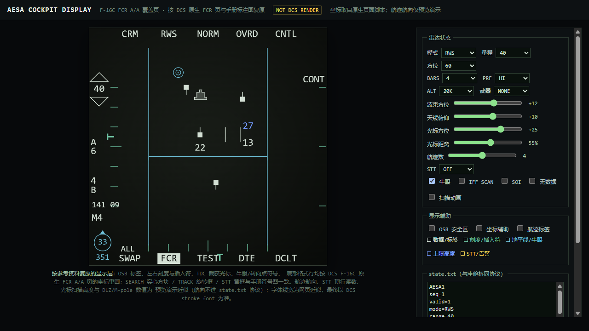

# 3b 座舱页面设计：覆盖 F-16C FCR A/A 页

状态：draft（2026-10-19）

实现：C1 页面/控制器/安装器已完成离线验证；实机启动被本机 DCS 环境阻塞。
范围：把 F-16C 原来的 A/A FCR 页面替换成自研 AESA 页面，含页面数据桥、HOTAS/OSB 交互；不含 3c 帧内渲染、VR HMD、多人完整性校验。

相关：[阶段三路线](feasibility.md) · [DCS 兼容层](dcs-compat.md) · [架构边界](architecture.md)

---

## 1. 参考：F16V 的页面是什么

`F16V Pobit MOD v1.98` 不是“在官方 MFD 里加一页”，而是：

1. **替换 F-16C 座舱 3D 模型**：`mainpanel_init.lua` 把 `shape_name` 改成 `F16V_Cockpit_Test_019`，并在 `device_init.lua` 注册新的座舱设备和 indicator。
2. **中央加一块竖屏 MPCD**：开口约 `153.4 × 225.6 mm`，native 单位约 `476 × 700`；不是官方 F-16 的方形 MFD。
3. **页面由 DCS indicator 元素绘制**：`F16V_MPCD/Native/overlay.lua`、`Native/page.lua`、`hsi.lua`、`fly.lua` 等用 `CreateElement`/`Add` 画线、字、盒、贴图；页面元素通过 `element_params` 绑定座舱参数。
4. **原生 DLL 承担 DCS 内部读数/渲染**：`F16V_MPCD_native.dll` 通过 `package.loadlib` 载入，`backend.lua` 调 `snapshot/present/map_frame/...`，把原生 MFD/地图/视频/雷达数据变成 Lua 参数或纹理。
5. **交互是“26 个物理 OSB + DMS”**：`controls.lua` 定义 26 个按键和 4 个旋钮；`Input/bindings.lua` 把它们绑到自定义设备；`dms_route.lua` 在输入层把 F-16 原有 DMS 改路由到 MPCD，实现短按选 SOI/切页、长按只切页。
6. **四个格式槽 + HSI 快捷键**：默认 `TGP/HSD/FCR/FLY`；底部 `HSI TGP HSD FCR FLY`；格式菜单可选 `BLANK/HAD/FLY/HSD/WPN/TGP/FCR`。

参考截图（外部发布帖）：

- [中央 MPCD 总览](https://forum.dcs.world/uploads/monthly_2026_10/00_Cover_TGP.jpg.990573e51a410e9b7ccf1cc6dace5c2a.jpg)
- [FCR / AZ-EL 页](https://forum.dcs.world/uploads/monthly_2026_10/04_FCR_AZEL_Missile_Display.jpg.42f934ad81a0008b30b93cec08c6046e.jpg)
- [HSI 地图页](https://forum.dcs.world/uploads/monthly_2026_10/05_HSI_Map.jpg.5c90867f44f4f151686a3318340f5743.jpg)
- [FLY 飞行页](https://forum.dcs.world/uploads/monthly_2026_10/01_FLY_Flight_Display.jpg.2624297e590dbe9bf932a39bdb2f4bca.jpg)

视觉共同点：

- 黑底、白/绿主色、黄/红只用于告警和 STT；
- 笔画字体、细线、无圆角面板；
- 边缘一圈 OSB 标签，底部 5 个格式槽；
- 中央主视图占绝大部分面积，数据块贴边，不抢主视图；
- 竖屏时主视图上方/下方可以分栏（FLY + HSI，或 HSI + ADI）。

F16V 的页面代码质量很高，但**不能直接复制**：仓库里只有发布包，没有许可证/源码授权；`F16V_MPCD_native.dll` 是闭源二进制。我们可以参考布局、交互语义和工程方法，代码要自己写。

---

## 2. 官方 F-16C 的硬约束

### 2.1 官方 MFD 页面不能吃外部数据

官方 `MFD_FCR_AA.lua` 只做声明式布局：

```lua
addStrokeText("FCR_STT_Altitude", "", ..., {{"MFD_FCR_AA_TrackedTarget_Altitude"}, ...})
addPlaceholder("DBG_AA_RadarContactsKeeper", nil, nil,
    {{"FCR_RadarContactsShow"}, {"MFD_updateMultipleSymbolsBuffer", DYNAMIC_DATA.RADAR_CONTACTS}})
```

`MFD_FCR_AA_*`、`RADAR_CONTACTS` 由 `F16::avRadar_APG68_F16` 原生设备写入。座舱 Lua 不访问 `world.*`/`LoGet*`，也没有 socket；**不能把自研 AESA 的航迹直接喂进官方 FCR 页**。这一点在 `docs/feasibility.md` 已有结论。

### 2.2 外部 Export 也不能直接写座舱参数

`Scripts/Export.lua:1249-1327` 明确写着：`get_param_handle`、`a_cockpit_*` 等是 **cockpit device Lua** API，不在 Saved Games 的外部 `Export.lua` 环境。外部 Export 能读世界、发 socket，但不能直接把数值写进 MFD 参数表。

因此 AESA 页面的数据必须走一条**座舱内桥**：

```text
AESA 核心/接收端（外部进程）
   │ 10 Hz 紧凑状态（文件 / 共享内存）
   ▼
座舱内 avLuaDevice controller
   │ get_param_handle(...):set(...)
   ▼
ccIndicator 页面元素（element_params/controllers）
```

### 2.3 页面本身可以用纯 Lua 画

`ccIndicator` 页面可以用 `addStrokeText/addStrokeLine/addStrokeSymbol/addPlaceholder` 等官方 helper 画出来；不需要原生 DLL 才能显示 A/A 的 B-scope、字符、航迹符号。**原生 DLL 只在需要画 SAR 图像/视频纹理时才需要。**

这给我们一个低风险的第一步：**先做纯 Lua 的 A/A 页面 + 文件桥**，把页面、数据、交互跑通；SAR 图像后置。

---

## 3. 已选路线：覆盖原 FCR A/A 页面

用户决定：不做新格式槽，直接**接管 F-16C 原来的 A/A FCR 页面**，效果参考 F-15E 的雷达页。

### 3.1 行为

- 飞行员仍按原来的方式把 FCR 选到 A/A；原生 `F16::avMFD_F16` 仍负责页面切换、电源、亮度、SOI。
- 页面内容不再由 `MFD_FCR_AA.lua` 的原生 APG-68 符号组成，而是我们的 AESA 页。
- FCR 的 STBY / A/G / IFF 页保持原生，不碰。
- 左、右 MFD 都使用同一个 `PAGE_FCR_AA`，因此两块屏都会显示 AESA 页；这符合“覆盖原页面”，不是新增页面。

### 3.2 实现方式

只改页面组合，不改原生 FCR 设备：

```lua
-- MFD_Pages_Init.lua
local SUBSET_AESA_AA = counter()
page_subsets[SUBSET_AESA_AA] =
    PagesPath.."FCR/MFD_FCR_AESA_AA.lua"

pages[PAGE_FCR_AA] = {SUBSET_BASE, SUBSET_AESA_AA, SUBSET_BASE_MENU, SUBSET_SOI}
```

这样：

- `pages_by_mode` 的 FCR A/A 映射不动，原生设备照常进入 `PAGE_FCR_AA`；
- 原 `MFD_FCR_AA.lua` 不再挂在该页上，但文件保留（可随时还原/对照）；
- `SUBSET_BASE` 提供 MFD 背板；`SUBSET_SOI` 提供 SOI 边框；`SUBSET_BASE_MENU` 提供底部格式行（原生 MFD 设备驱动，当前格式白底黑字反色）；
- 我们的页面自己画全部雷达数据与 OSB 标签（底部格式行除外），绘制顺序在 `SUBSET_BASE_MENU`/`SUBSET_SOI` 之下。

### 3.3 为什么不是“加一页”

- 加一页需要新格式/模式/OSB 入口，还要和原生 FCR 模式竞争；
- 用户要的是“原来那个 A/A 雷达页变成 AESA”，不是多一个可选页；
- 覆盖页面组合最小、可逆，容易和 F16V 共存：F16V 改的是它自己的 `F16V_MPCD` 页，不碰官方 `MFD_Pages_Init.lua`。

### 3.4 与 F16V 的关系

- F16V 保留左右两块官方 MFD；我们的页显示在左/右 MFD 的 FCR A/A 位置，F16V 的中央 MPCD 独立工作。
- 不复制 F16V 的代码；不依赖 `F16V_MPCD_native.dll`。
- 以后若要把同一页放进 F16V 中央竖屏，复用 `src/cockpit/` 的状态/绘制模型，只换 layout 和页面注册层；见 §9。

### 3.5 当前实现（C1）

已写入：

- 页面：[`src/adapters/dcs/cockpit/page/MFD_FCR_AESA_AA.lua`](../src/adapters/dcs/cockpit/page/MFD_FCR_AESA_AA.lua)（C1.5 起为按原生坐标复原的新布局；C1.6 起 265 个声明元素，参数绑定全部在 `Add()` 时完成——引擎只在 `Add()` 内绑定 `element_params`/`controllers`，事后赋值不生效（C1.5 实机"全部停留默认值/NO DATA"缺陷的根因）；文本用裸参数名简写绑定，门控用等值简写，顶行用原生 `add_PB_label`）
- 控制器：[`src/adapters/dcs/cockpit/controller.lua`](../src/adapters/dcs/cockpit/controller.lua)（C1.5 起为新投影 `x=az×2`、`y=-240+range/scale×480`，解析增量字段 `own/beam_el/cursor/extra` 与 track 第 7 字段 hdg；C1.6 起在加载时预声明全部 87 个 `AESA_*` 参数——参数注册表跨 Lua 状态共享，页面构建后才创建的名字可能永远绑不上页面；同一份清单由安装器写进 device_init 注册块（线程启动前串行声明，F16V `parameters.lua` 模式），测试锁定两侧一致）
- 安装器：[`scripts/install_cockpit.cjs`](../scripts/install_cockpit.cjs)
- 状态桩：[`tools/cockpit_bridge_stub.cjs`](../tools/cockpit_bridge_stub.cjs)（仅心跳，供安装联调）
- 数据桥：[`tools/cockpit_bridge.py`](../tools/cockpit_bridge.py)（C1.5 新增：核心 snapshot → `state.txt` 10 Hz 原子写；经 `live.py --cockpit-state <path>` 接入实时/回放管线）
- 显示层预览：[`tools/cockpit_preview.html`](../tools/cockpit_preview.html)（单文件、无依赖；版面按原生 FCR A/A 页坐标复原，可调模式/量程/方位/BARS/天线俯仰/光标/航迹/STT/武器/牛眼/SOI 等，导出同协议 `state.txt`）


- 离线测试：[`tests/test_cockpit_page.cjs`](../tests/test_cockpit_page.cjs)、[`tests/test_cockpit_bridge.py`](../tests/test_cockpit_bridge.py)

已验证：

- Lua 5.1 语法通过；
- 页面在桩环境生成 265 个元素，8 个航迹槽（SEARCH/TRACK/STT 三变体 + 航向旋转 + TUC 高度）；
- 桩在注册时快照每个元素的 `controllers/element_params/formats`，`Add()` 后的任何绑定变更直接判红（防 C1.5 回归）；
- 控制器/安装器/页面三方的 `AESA_*` 参数清单一致（控制器预声明 = device_init 预声明 ⊇ 页面引用）；
- 控制器能把 `TWS / 3 航迹 / STT / 航向 / 俯仰滚转 / 光标` 写入命名参数；无效帧会清空页面；
- 数据桥回放真实录制可产出合规 `state.txt`（排序/截断 8 条/`extra`、单位换算、断链 `valid=0`）；
- 安装器在临时 F-16C 模块树上 `install → verify → uninstall`，两个官方文件逐字节还原；
- 全部离线测试通过（座舱页 4/4、状态桥 12/12）。

实机进度（2026-10-20）：

- 本机 DCS 已可正常进任务（白天 `edCore/ntdll` 启动崩溃为输入法/安全软件注入诱因，自行消失，不追查）。
- C1.5 实机首飞：页面组合生效（覆盖行在 `makePagesCommon()` 之后），但全部参数元素停在默认值、黄字 `NO DATA` 常亮；诊断日志证明 Export→桥→`state.txt` 链路正常、座舱态文件读取成功，断点在参数绑定。C1.6 按上文的绑定纪律修复并已装机（`install/verify` 通过）。
- 观感按原生坐标迭代过一轮：删自画边框、底部格式行改由原生 `SUBSET_BASE_MENU` 提供、顶行移到 `{x,237}` 并由 `add_PB_label` 自带遮罩在 SOI 框上开缺口、量程三角换原生 `Decrement-symbol`、`M4` 移到原生 `{-235,-145}` 锚点。
- 待下次飞行确认：参数是否全部动起来（NO DATA 消失）、SOI 缺口与顶行高度观感、`own=` 俯仰/滚转驱动地平线的符号方向。

---

## 4. 页面形态


> 2026-10-19 第二版：按 DCS 原生 FCR A/A 页面脚本（`MFD_FCR_AA.lua` 等）的元素坐标与手册 FCR A/A 标注图重画显示层，替换此前按实机截图重排的第一版；更早的"目标表 + 底部格式槽"概念图仅保留在 [cockpit-page-concept-square.png](cockpit-page-concept-square.png) 作为历史稿。预览不是 DCS 实机截图；最终字形、线宽和坐标以 DCS 页面实现为准。

### 4.1 方形 F-16 MFD

布局以 DCS 原生页面脚本（`MFD_FCR_AA.lua`、`MFD_FCR_COMMON.lua`、`MFD_FCR_BASE.lua`、`MFD_FCR_IFF.lua`、`MFD_BASE_MENU.lua`、`MFD_SOI.lua`，及 `MFD_Symbology.lua` 的 `PB_positions`/`addCaret`/`addFcrSteerpoint`）与手册 FCR A/A 标注图为坐标依据；`tools/cockpit_preview.html` 按同一坐标系（中心 `(0,0)`、四边 `±240`、y 向上）重画。顶部 PB1 沿用 `CRM`，不再放 AESA 产品标。

- 边框：不画——屏幕边缘即物理 bezel，原生页面也不画边框（2026-10-19 实机确认自画边框会挤压 OSB 标签带观感，已删）。
- OSB 标签：顶行 `CRM / RWS / NORM / OVRD / CNTL`（PB2 随子模式变 `RWS/TWS/STT`）走原生 `add_PB_label`——文本锚点 `{x, 237}` `CenterTop`，且每个标签自带裁剪遮罩，在 SOI 框上沿开出围绕文字的缺口；底部格式行 `SWAP / [当前格式] / TEST / DTE / DCLT` 由页面组合里的原生 `SUBSET_BASE_MENU` 提供（原生 MFD 设备驱动，当前格式为白底黑字反色），本页不画；右列仅 `CONT`（`{214,135}`，带 2×20 边缘遮罩），右缘 3 条距离标（对应量程的 3/4、1/2、1/4）。
- 左列：量程簇根 `{-220, 116}`——量程值（带原生描边底层）与增/减空心三角用原生 `stroke_symbols_MFD` 的 `Decrement-symbol`（scale 3.5，`{0,±25}`，上三角为同符号旋转 180°；量程 160 藏 △、5 藏 ▽），簇带 2×72 边缘遮罩；方位档 `A6/A3/A1`（字母+数字两行，原生 PB18 锚点 `{-237,-1}` `LeftCenter`）、仰角层数 `4B/3B/2B/1B`（数字+B 两行，PB17 锚点 `{-237,-79}`）、`M4`（原生 IFF 读数锚点 `{-235,-145}` `LeftCenter`，静态显示直到核心长出 IFF 模型），IFF 扫描时加 `SCAN`；另有光标相对转向点的方位/距离读数（如 `042 11`，`{-235,-119}`）。
- 刻度与插入符（teal）：底部方位刻度 7 条竖刻（中心加长，根 `{0,-212}`），左缘俯仰刻度 7 条横刻（根 `{-197,0}`）；天线方位/俯仰插入符为三线厚度 T 形，分别挂在底刻度下方（`{0,-218}`）、左刻度左方（`{-203,0}`，旋转 90°），随波束方位/天线俯仰移动。
- 中央 B-scope：cyan 地平线（随俯仰上下移动，两端向下小竖刻）、两条方位扫描限竖线（A6→±120 单位）、牛眼同心圆、转向点 wedding-cake 多边形；TDC 截获光标为两条竖线，右侧上限（蓝）/下限（白）两位千英尺扫描高度。目标投影：`x = 方位×2`（|方位|>63 不画）、`y = -240 + 距离/量程×480`。
- 目标符号：SEARCH=白色实心方块（vc<-50 热线下垂、vc>50 冷线上指；只有离光标最近的那条 SEARCH 显示高度——TUC 行为）；TRACK=12×12 空心方块按航向旋转 + 机头线 + 下方高度；STT=黄色 18×18 空心方块 + 外圈 + 上方方位指针 + 黄色高度，并隐藏 TDC 光标，顶行显示方位角/地面航迹/CAS/接近率（原生锚点 y=215）。
- 武器联动：武器=AIM-120 时底部 `RDY`；STT 且 AIM-120 时右侧画 DLZ 线性导弹比例尺（RMax1/RMax2/RMin2/RMin1 刻度 + 目标距离左指三角 + M-pole/F-pole + T2），中央画 ASE 圆 + ASC 点。
- 左下：牛眼 LOS（圆 + 距离 + 下方方位 + 圆顶航向小三角），关闭时改画本机参照符 + 操纵十字；`ALL` 数据链去混杂标注；SOI 时由原生 `SUBSET_SOI` 画 `±240` 白框（线宽 2.9），顶/底/左/右四边经标签遮罩留出缺口；无数据时黄字 `NO DATA` 并清空目标。
- 颜色：白=数据/文字，teal=刻度/插入符，cyan=地平线/牛眼/扫描限，蓝=上限高度，黄=STT/告警；背景近黑绿渐变。
- 预览的演示近似（不进 state.txt 协议）：航迹航向（与 SAMPLES 并行的固定表）、STT 顶行读数、光标扫描高度、DLZ 比例与 M/F-pole、牛眼 LOS 与光标-转向点方位距离均为演示计算值，最终以座舱页实现为准。

### 4.2 竖屏 F16V 版本（后续）

同一套状态/绘制模型，layout 改为 `476 × 700`，主视图更高，保留同样的顶部/左右/底部层级；中央 MPCD 的 26 个 OSB 和 DMS 可直接复用。此版本只在获得 F16V 作者许可后进入分发。

---

## 5. 模式与交互

### 5.1 模式

第一版只做三种 A/A 模式：

| 模式 | 行为 | 页面 |
|---|---|---|
| RWS | 搜索、航迹历史、无锁定 | 扫描扇区 + 接触点 |
| TWS | 多目标跟踪、航迹表 | 航迹框 + 速度矢量 |
| STT | 单目标跟踪 | 大目标框 + 距离/接近速度/高度 |

### 5.2 OSB

第一版计划：

- `RANGE +/−`：80/40/20/10 NM；
- `AZ ±60/±30/±10`；
- `BARS 2/4/6`；
- `PRF HI/MED/ILV`；
- `MODE RWS/TWS/STT`；
- `FREEZE`：冻结画面，底层继续跟踪；
- 页面底部的 `HSI/AESA/SAR/DL/FLY` 只作为显示标签，不抢原生 MFD 的格式切换。

OSB 的实际按键路由是 C2 的难点：官方 MFD 的 20 个 OSB 命令默认发给 `devices.MFD_LEFT/RIGHT`，不是我们的设备。第一版先做 **HOTAS-only + 页面状态**，OSB 路由在 C2 单独验证，不能假装已经可用。

### 5.3 HOTAS

按 F-16 习惯，先定义“AESA 页为 SOI 时”的行为：

| 输入 | 行为 |
|---|---|
| DMS Down 短按 | 选 AESA 页为 SOI；已 SOI 时切格式 |
| DMS Down 长按 | 只切格式，不抢 SOI |
| TMS Up | 锁定光标附近最近航迹 / 进入 STT |
| TMS Right | 循环下一个航迹 |
| TMS Down | 解除 STT，回 TWS/RWS |
| TMS Left | 切 RWS/TWS |
| TDC 移动 | 移动光标；页面显示方位/距离 |
| TDC 按下 | 指定光标处为目标（有航迹则 STT） |
| 天线 elevation | 调整扫描中心 |
| Uncage | 扫描中心回自动 |

实现顺序：DMS（页面/SOI）→ TMS（模式/STT）→ TDC（光标）→ 天线 elevation。每一步都要有独立测试，不能一次全上。

---

## 6. 数据契约

### 6.1 外部 → 座舱（10 Hz）

固定、紧凑、可丢帧。C1.5a 起由 `tools/live.py --cockpit-state <path>` 以 ~10 Hz 原子写出（映射在 `tools/cockpit_bridge.py`），当前实现格式：

```text
AESA1
seq=12345          ; 每次写出递增（数据不变也递增；座舱侧靠 seq 判活）
valid=1            ; 链路连通且最近 1 s 内有帧，否则 0
mode=RWS           ; 派生显示语义：有 STT 航迹→STT，有 confirmed→TWS，否则 RWS
range=40           ; 显示量程自动档：10/20/40/80/160 NM 中能装下最远航迹的最小档
az=60              ; 扫描半方位 ±deg（cfg.az_span_deg/2）
bars=4             ; 俯仰条数（#cfg.el_bars_deg）
prf=HI             ; beam.prf 直传（HPRF/MPRF/…），无波束时 HI
alt=30             ; 本机高度 kft 取整；未知 ---
scan=AUTO          ; 固定 AUTO（C2 接 HOTAS 后才有实义）
beam=-15           ; 波束方位 deg 取整；无波束 0
beam_el=4          ; C1.5a 新增：波束俯仰 deg 取整
own=270,-2,0       ; C1.5a 新增：本机航向/俯仰/滚转 deg 取整（航向归一 [0,360)）；own 缺失整行省略
hz=10.0            ; 实测写出频率
track=01,5,10,428,20000,STT,90
;   track=serial,az_deg,range_nm,vc_kt,alt_ft,STATUS[,hdg_deg]
;   serial 从 01 递增（显示序号）；STATUS ∈ SEARCH|TRACK|STT
;   第 7 字段 hdg_deg 可选（atan2(ve,vn) 归一 [0,360)；速度矢量缺失时省略）
extra=2            ; 航迹超过 8 条被截断时的剩余数量（仅截断时出现）
```

兼容性：除 `AESA1`/`seq`/`valid` 外所有行均为可选行，`track=` 第 7 字段为可选字段；解析方对未知键一律忽略、缺字段走默认值。因此旧心跳桩（`tools/cockpit_bridge_stub.cjs`）、`tools/cockpit_preview.html` 与现有 controller 对本格式仍可解析，本格式对旧解析方也向后兼容。

最多 8 条航迹；排序 STT > confirmed > 距离近优先，截断部分写 `extra=<N>`，页面标注 `+N`。所有角度用度、距离用 NM、速度用节、高度用 ft（m→NM /1852、m/s→kt ×1.94384、m→ft ×3.28084，在桥内收口）；页面不再换算物理量。

实现先用**文件桥**：

- 外部服务原子写 `Saved Games/DCS/Scripts/AESA-COCKPIT/state.txt`（临时文件 + rename）；
- 座舱 controller 每 0.1 s `io.open` 读一次；解析失败保留上一帧并计数；
- 延迟/丢帧显示在页面角标，不静默假装正常。

如果实测 DCS 主线程文件 I/O 造成卡顿，再换**原生 DLL + 共享内存**：DLL 只做 `CreateFileMapping` 读取和 `get_param_handle` 写入，不碰游戏世界；这样不依赖 F16V 的 DLL。

### 6.2 座舱 → 外部（事件）

页面只写“意图”，不写物理：

```text
seq=7
cmd=range_down
cmd=mode_tws
cmd=stt
id=3
```

用 `command.txt` 追加；外部服务读后截断。事件频率低，不需要共享内存。

### 6.3 参数数量

第一版控制在约 80 个参数：

- 8 条航迹 × 8 字段 = 64；
- 页面状态/波束/本机/告警约 16。

DCS 参数是命名 handle，数量本身不是硬限制；但每帧写几百个参数会拖慢主线程。只写变化值，航迹表用固定槽位，不动态创建元素。

---

## 7. 代码落点

```text
src/cockpit/                 # 纯 Lua，无 DCS API、无 IO
├─ state.lua                 # 页面状态机：模式/量程/光标/STT/告警
├─ layout.lua                # 480×480 / 476×700 的几何与投影
├─ page.lua                  # 绘制命令（backend 接口）
└─ format.lua                # 数字/单位/标签格式化

src/adapters/dcs/cockpit/    # DCS 绑定
├─ controller.lua            # avLuaDevice：读桥、写参数、收命令
├─ page_dcs.lua              # 把 page.lua 的绘制命令变成 addStroke*/element
├─ page_init.lua             # ccIndicator 几何/页定义（第一版只做 FCR AA 覆盖）
├─ bridge_file.lua           # 第一版文件桥；后续可替换为 native
└─ install_patch.lua         # 安装器用的页面组合补丁（标记块）

src/adapters/dcs/cockpit/page/
└─ MFD_FCR_AESA_AA.lua       # 部署到 F-16C Pages/FCR/ 的页面文件

tests/
├─ test_cockpit_state.py     # 纯状态机 + 投影
├─ test_cockpit_page.cjs     # 绘制命令快照（假 backend）
└─ test_cockpit_bridge.py    # 状态文件解析/丢帧/截断

tools/
└─ cockpit_preview.cjs       # 用示例帧渲染 SVG/PNG，做视觉验收
```

边界：

- `src/cockpit/` 不出现 `get_param_handle`、`LoGet*`、`lfs`、`io`、DCS 机型名；
- `src/adapters/dcs/cockpit/` 是唯一接触 DCS API 的地方；
- 页面不计算 RCS/探测概率/分辨率，只消费 DTO；
- 不复制 F16V 代码；布局常量自己测量/定义，注明参考来源。

---

## 8. 部署

第一版必须写入 DCS 安装目录（F-16C cockpit 脚本不在 Saved Games）：

- 新文件：`Mods/aircraft/F-16C/Cockpit/Scripts/AESA/`；
- 补丁块：`Displays/MFD/indicator/MFD_Pages_Init.lua` 的 `SUBSET_AESA_AA`/`PAGE_FCR_AA`；
- 设备注册：`device_init.lua` 增加 `devices.AESA = 240` 与 `avLuaDevice` controller（仅用于桥/参数）；
- 备份/还原：安装器记录改前 hash，按标记块精确还原；不覆盖用户/其他模组的修改；与 F16V 的 marker 块共存。

不修改 `MFD_FCR_AA.lua` 本体，只改页面组合；卸载时恢复 `MFD_Pages_Init.lua` 的原始行即可。

---

## 9. 里程碑

### C0（spike，1–2 天）

- [x] 用最小 `MFD_FCR_AESA_AA.lua` 替换 `PAGE_FCR_AA`；
- [x] controller 读 `state.txt`，把 `seq` 发布为页面参数；
- [x] 安装器 `install → verify → uninstall` 在临时模块树上通过；
- [ ] 实机确认页面刷新、无崩溃、无卡顿（DCS 启动阻塞）。

C0 的代码/安装链路已就绪；实机项未通过，不能判 Green。

### C1（A/A 页面）

- [x] RWS/TWS/STT 模式显示；
- [x] 8 航迹槽 + 三行目标表 + 波束/扫描扇区；
- [x] 状态文件丢失时 `NO DATA`，不保留旧目标；
- [ ] OSB 量程/模式/冻结（当前只画标签，按键后置）；
- [ ] 实机视觉验收（DCS 启动阻塞）。

### C2（交互）

- DMS 短/长按；
- TMS/TDC（先做页面内命令，再决定输入路由）；
- 与 F16V 共存测试（F16V 中央 MPCD + 我们覆盖的右 MFD FCR AA）。

### C3（集成/分发）

- 安装器：DCS 安装目录文件清单、备份、精确还原、OvGME/JSGME 结构；
- 若获 F16V 作者许可：把同一页做成 F16V 竖屏格式，复用 `src/cockpit`；
- SAR 图像页另开：需要纹理/共享内存，不在 C1 范围。

---

## 10. 测试与验收

C0：

- 页面出现/消失由页面组合控制，不依赖任务脚本；
- `state.txt` 10 Hz 更新 60 s，DCS 帧时间无可测下降；
- 断桥 5 s 后页面显示 `NO DATA`；恢复后自动重连；
- 退出任务/重进不崩溃。

C1：

- 纯 Lua 状态机测试：RWS→TWS→STT→RWS；量程循环；8 条截断；无效帧丢弃；
- 绘制快照：固定输入产生固定绘制命令（坐标/文本/颜色）；
- 视觉验收：截图对照本文布局，不出现文字越界/符号叠压；
- 实机：FCR A/A 页显示 AESA；FCR STBY/A/G 仍是原生页；F16V 中央 MPCD 不受影响；F-16 原生 HSI/其他 MFD 仍正常。

不可用 `skip` 代替实机；没有 DCS 时只能标 `blocked`，不能判 C0/C1 完成。

---

## 11. 待定

1. OSB 路由：第一版只做 HOTAS，还是同时改 `Input/Loader.lua` 把 MFD OSB 转发到我们的设备？
2. 数据桥：先文件桥，还是直接原生共享内存 DLL？
3. `devices.AESA = 240` 是否与用户现有模组冲突；安装器需要扫描并 fail-closed。
4. F16V 作者的授权/联系渠道；没有则竖屏版本只做本机实验，不进发布。
